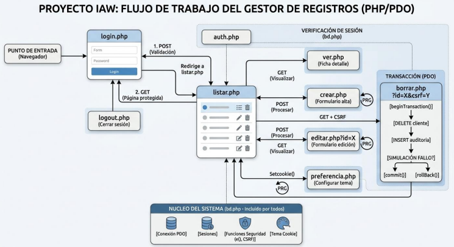

 

# PROYECTO-IAW
Mini-Proyecto PHP + PDO + Seguridad

## Introducción
En este proyecto, se creará una base de datos con el lenguaje de programación PHP y los lenguajes de marcas HTML y CSS.

/ (Raíz del proyecto)
  
├── bd.php # Conexión PDO, funciones de seguridad (e(), CSRF) y
control de sesión
  
├── login.php # Formulario e inicio de sesión de usuarios

├── logout.php # Destrucción de la sesión activa

├── listar.php # Panel principal: Listado con filtro de búsqueda y
paginación

├── ver.php # Ficha de detalle de un registro específico

├── crear.php # Formulario y procesador para añadir un nuevo registro
(PRG + CSRF)

├── editar.php # Formulario y procesador para modificar un registro
existente

├── borrar.php # Borrado mediante Transacción (beginTransaction +
auditoría)

├── preferencia.php # Cambio de preferencia visual guardada en una Cookie

├── schema.sql # Script DDL para la creación de las tablas de la BD

└── seed.sql # Datos iniciales de prueba (usuarios y registros)

Título, portada, integrantes, fecha del trabajo

PROYECTO-IAW

Samuel Garcerán López y Daniel Blázquez Marín

26/11/2026 y 27/11/2026

Tipo de proyecto: descripción /explicación de en que consiste tu
mantenimiento.

Configuración inicial realizada.

Base de datos creada y tablas del proyecto.

Hemos creado la base de datos 3D-SPECTRUM y las tablas que hay en el proyecto son auditoria, clientes, productos y copias de seguridad.

Funcionalidad del proyecto: traza de toda la funcionalidad (flujo que sigue el programa), desde login hasta el final con capturas de pantalla y explicando que hace.

En caso de error de contraseña o usuario muestra el error "Credenciales incorrectas".

Dentro del menú de administración de clientes, es posible modificar los datos de la tabla denominada clientes, pudiendo añadir, visualizar y eliminar usuarios.

Opciones al añadir un nuevo usuario a la tabla denominada clientes.

Opciones al editar el cliente seleccionado.

Visualización de los datos de un cliente de la tabla denominada clientes.

También, es posible cambiar el tema predeterminado a modo oscuro o blanco desde el menú de administración.

Incluso también es posible cerrar sesión con el usuario actual y mantener el tema seleccionado anteriormente

Nuevas funcionalidades añadidas: mejoras añadidas.

Añadir una tabla de clientes con clientes, añadir una tabla de copias de seguridad donde almacenar los dumps y una tabla de productos donde se almacenan productos.

Problemas encontrados y como se han solucionado.

Se han encontrado los siguientes problemas: crear usuarios y asignarles permisos. Solución: dar todos los permisos mediante GRANT ALL PRIVILEGES.

Ejecutables.
